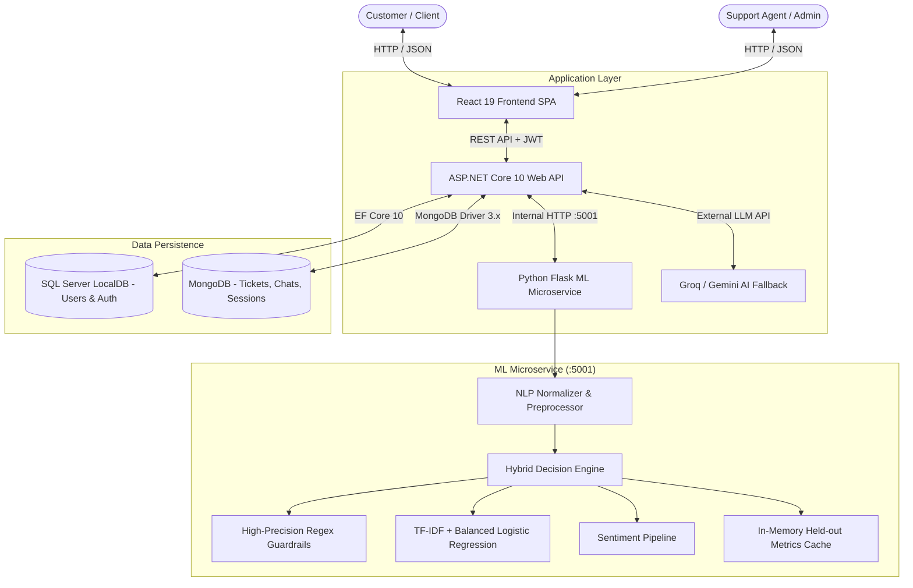

# AI-CARE: AI-Driven Customer Assistance & Real-Time Escalation Framework

[](https://dotnet.microsoft.com/)
[](https://react.dev/)
[](https://www.python.org/)
[](https://www.mongodb.com/)
[](https://www.microsoft.com/sql-server)
[](LICENSE)

---

## 📌 Executive Summary

**AI-CARE** (AI-Driven Customer Assistance and Real-Time Escalation) is an enterprise-grade, full-stack customer support platform designed to streamline customer communications, accurately categorize incoming inquiries, gauge sentiment, dynamically prioritize issues, and escalate complex requests into manageable support tickets.

The platform bridges real-time automated conversational intelligence with administrative workflows, combining a **hybrid machine learning classifier** with rule-based domain guardrails, stateful conversational session tracking, and high-performance database indexing.

---

## 🏛 Architecture Overview

AI-CARE employs a distributed, service-oriented architecture ensuring separation of concerns, scalability, and resilience:



### Core Architecture Components
1. **Frontend (`SPT/Frontend/login-app`)**:
   - Built with **React 19** and modern Vanilla CSS design systems.
   - User Chatbot with session-aware chat history, typing indicators, quick replies, and automatic action prompts.
   - Comprehensive **Admin Dashboard** featuring real-time KPI metrics, sentiment breakdowns, priority filtering, ticket inspectors, and live ML performance evaluation modals.
2. **Backend API (`SPT/dotnet-api/SupportAPI`)**:
   - Built on **ASP.NET Core 10**.
   - Handles authentication, JWT issuance, password hashing, and role-based authorization.
   - Implements multi-turn conversational context inheritance (`ChatSessionController`), ticket lifecycle management (`TicketController`), and duplicate prevention.
   - Communicates with the ML microservice via non-blocking HTTP (`MLService`).
3. **Machine Learning Microservice (`SPT/ML_API`)**:
   - Built with **Python Flask** and **Scikit-Learn**.
   - Features a **Hybrid Operational Classifier** combining high-precision regex pattern matching with a balanced Logistic Regression model ($C=5.0$) trained on clean, deduplicated support corpora.
   - Sentiment analysis classifier trained on 24,000+ customer reviews and social support queries.
   - Cached held-out metrics endpoint (`/metrics`) responding in under 5ms.
4. **Data Stores**:
   - **SQL Server LocalDB**: User profiles, credentials, and authentication tables via Entity Framework Core.
   - **MongoDB**: High-throughput storage for tickets, conversation turns, and multi-turn chat sessions with compound indexing on `(userEmail, createdAt)` and `(status, priority)`.

---

## 📁 Repository Directory Structure

```text
AI-Smart-Customer-Support/
├── .github/                       # GitHub workflows and CI configurations
├── .gitignore                     # Universal gitignore (.NET, Node, Python, Datasets)
├── README.md                      # Primary project documentation (this file)
├── SPT/                           # System Project Trunk (Source Code)
│   ├── SPT.sln                    # Visual Studio Solution File
│   │
│   ├── dotnet-api/                # Backend API (.NET 10)
│   │   └── SupportAPI/
│   │       ├── Controllers/       # API Controllers (Chat, Ticket, Session, Auth)
│   │       │   ├── AuthController.cs
│   │       │   ├── ChatController.cs
│   │       │   ├── ChatSessionController.cs
│   │       │   └── TicketController.cs
│   │       ├── Data/              # EF Core DB Context (LocalDB)
│   │       │   └── AppDbContext.cs
│   │       ├── Model/             # Data Entities (DTOs & Database Models)
│   │       │   ├── ChatMessage.cs
│   │       │   ├── ChatSession.cs
│   │       │   ├── Ticket.cs
│   │       │   └── User.cs
│   │       ├── Services/          # Core Business Logic & External Clients
│   │       │   ├── AIService.cs       # LLM fallback (Groq / Gemini)
│   │       │   ├── EmailService.cs    # SMTP notifications
│   │       │   ├── JwtService.cs      # Token issuance and validation
│   │       │   ├── MLService.cs       # ML microservice connector & health
│   │       │   └── MongoService.cs    # MongoDB repository layer
│   │       ├── appsettings.json   # Connection strings and configuration
│   │       ├── Program.cs         # Dependency injection and middleware pipeline
│   │       └── SupportAPI.csproj  # .NET project definitions
│   │
│   ├── Frontend/                  # User Interfaces
│   │   ├── Admin Dashboard/       # Standalone Admin Dashboard components
│   │   ├── Chatbot/               # Standalone Chatbot components
│   │   └── login-app/             # Complete Single Page Application (React 19)
│   │       ├── public/            # Static HTML, manifest, and icons
│   │       ├── src/
│   │       │   ├── components/    # Reusable UI Components
│   │       │   │   ├── AdminDashboard.jsx  # Real-time metrics & management
│   │   │   │   ├── AdminDashboard.css  # Dashboard glassmorphism styles
│   │   │   │   ├── AdminRoute.jsx      # Role-based route guard
│   │   │   │   ├── Chatbot.jsx         # Interactive floating support widget
│   │   │   │   ├── Chatbot.css         # Chatbot theme & animations
│   │   │   │   ├── ChatSidebar.jsx     # Session history sidebar
│   │   │   │   ├── Dashboard.js        # User home dashboard
│   │   │   │   ├── Login.jsx           # Secure authentication form
│   │   │   │   └── Register.jsx        # Account registration
│   │       │   ├── services/      # Frontend API clients (Axios/Fetch)
│   │       │   │   └── api.js
│   │       │   ├── App.js         # Client-side router configuration
│   │       │   └── index.js       # React root mount point
│   │       └── package.json       # Node package dependencies
│   │
│   └── ML_API/                    # Machine Learning Service (Python Flask)
│       ├── app.py                 # Microservice routes, models, and training
│       ├── category_model.pkl     # Trained category classifier (TF-IDF + LogReg)
│       ├── sentiment_model.pkl    # Trained sentiment classifier
│       ├── independent_benchmark.json # Independent evaluation set (N=160)
│       ├── provisional_benchmark.json # Development regression benchmark (N=80)
│       ├── requirements.txt       # Python package requirements
│       ├── all_tickets_processed_improved_v3.csv  # IT tickets corpus
│       ├── customer_support_tickets.csv           # E-commerce tickets corpus
│       ├── twitter_training.csv   # Sentiment training data
│       └── twitter_validation.csv # Sentiment validation data
│
└── SRS/                           # System Requirement Specifications & Academic Docs
    ├── Project Report Template.docx
    └── ...
```

---

## ⚡ Key Features & Innovations

### 1. Hybrid Operational Classifier
Customer inquiries are processed through a two-stage classification engine:
1. **High-Precision Pattern Guardrails**: Regex-based domain detectors catch deterministic actions (e.g., refund demands, tracking numbers, coupon requests, login resets).
2. **Balanced Machine Learning Pipeline**: Unmatched queries pass to a Scikit-Learn pipeline featuring character and word n-grams (1-3) with class-balanced Logistic Regression ($C=5.0$) trained across 8 core categories:
   - `Account` | `Billing` | `General` | `Product` | `Promo` | `Returns` | `Shipping` | `Technical`
3. **Safety Fallback**: Queries with low ML confidence ($< 0.60$) and absent keywords safely default to `General` to avoid erroneous automated actions.

### 2. Contextual Conversation & Category Inheritance
In real-world customer support, follow-up messages rarely restate the problem category. For example:
- *Turn 1*: "I want to return my damaged shoes." $\rightarrow$ **Category: Returns**
- *Turn 2*: "Here is my order number: OD-98234120." $\rightarrow$ **Category: Returns (Inherited)**
- *Turn 3*: "What should I do next?" $\rightarrow$ **Category: Returns (Inherited)**

AI-CARE tracks active sessions via `ChatSessionController` and inherits the previous active category when follow-up messages lack conflicting category intent or contain order identifiers.

### 3. Real-Time Dynamic Priority Matrix
Every inquiry is mapped to an operational priority (`Low`, `Medium`, `High`, `Critical`) determined dynamically by category severity combined with detected sentiment:

| Category | Positive Sentiment | Neutral Sentiment | Negative Sentiment |
| :--- | :---: | :---: | :---: |
| **Billing** | Medium | High | **Critical** |
| **Returns** | Low | Medium | **High** |
| **Account** | Low | Medium | **High** |
| **Technical** | Medium | Medium | **High** |
| **Shipping** | Low | Medium | **High** |
| **Product / Promo** | Low | Low | **Medium** |
| **General** | Low | Low | **Low** |

### 4. Duplicate Ticket Prevention
To avoid ticket spamming, the `TicketController` analyzes new ticket submissions against open issues from the same user within a sliding time window (30 minutes). If an open ticket with identical content or category already exists, the API links the conversation rather than generating duplicate work items.

---

## 📊 Model Evaluation & Reproducibility Audit

AI-CARE has undergone rigorous evaluation across multiple independent benchmarks to ensure reliability, zero data leakage, and mathematical integrity.

### Benchmark Performance Summary

| Metric Dimension | Historical Contaminated Split | Clean Held-Out Split | Development Benchmark | Independent Operational Benchmark |
| :--- | :---: | :---: | :---: | :---: |
| **Evaluation Set ($N$)** | **2,098** | **1,986** | **80** | **160** |
| **Class Distribution** | Imbalanced ($9 \dots 784$) | Natural ($2 \dots 769$) | Balanced (10/class) | Balanced (20/class) |
| **Cross-Split Data Leakage** | 6.67% *(140 duplicate rows)* | **0.00%** *(Strictly isolated)* | N/A *(Curated)* | **0.00%** *(Untouched)* |
| **Raw ML Model Accuracy** | 57.01% | 53.47% | 65.00% | **43.75%** |
| **Raw ML Model Macro-F1** | 0.7067 | 0.4469 | 0.6558 | **0.4414** |
| **Operational Pipeline Accuracy**| N/A | 43.00% | 81.25% | **61.25%** |
| **Operational Pipeline Macro-F1**| N/A | 0.4327 | 0.8182 | **0.6322** |

### Independent Operational Benchmark Breakdown ($N = 160$, Balanced 20/Class)

The untouched, independent evaluation benchmark yields the following per-class metrics:

| Category | True Support | Precision | Recall | F1-Score | Operational Characteristics |
| :--- | :---: | :---: | :---: | :---: | :--- |
| **Account** | 20 | 0.9167 | 0.5500 | **0.6875** | High Precision, credential detection |
| **Billing** | 20 | 0.9000 | 0.4500 | **0.6000** | Catches unauthorized / invoice errors |
| **General** | 20 | 0.2857 | 0.6000 | **0.3871** | Conservative safe fallback sink |
| **Product** | 20 | 0.8750 | 0.3500 | **0.5000** | High Precision on product questions |
| **Promo** | 20 | 1.0000 | 0.9000 | **0.9474** | Robust coupon / discount extraction |
| **Returns** | 20 | 0.7857 | 0.5500 | **0.6471** | Reliable refund & exchange tracking |
| **Shipping** | 20 | 0.7778 | 0.7000 | **0.7368** | Fast courier / tracking matching |
| **Technical** | 20 | 0.4211 | 0.8000 | **0.5517** | Broad technical bug detection |
| **Overall (Unweighted)** | **160** | **0.7452** | **0.6125** | **0.6322** | **+17.5% Accuracy over raw ML** |

$$\text{Macro-F1} = \frac{0.6875 + 0.6000 + 0.3871 + 0.5000 + 0.9474 + 0.6471 + 0.7368 + 0.5517}{8} = \mathbf{0.632200}$$

---

## 🚀 Getting Started

### Prerequisites
- **.NET 10 SDK** installed (`dotnet --version`)
- **Node.js (v18+)** and **npm** (`node -v`, `npm -v`)
- **Python 3.10+** (`python --version`)
- **MongoDB** running locally on port `27017` (or MongoDB Atlas connection URI)
- **SQL Server LocalDB** (included with Visual Studio / .NET tools)

---

### Step 1: Clone the Repository
```bash
git clone https://github.com/Swarupanand05/AI-Smart-Customer-Support.git
cd AI-Smart-Customer-Support
```

---

### Step 2: Start the Python ML Microservice
The ML service provides prediction and metrics endpoints on `http://127.0.0.1:5001`.

```bash
cd SPT/ML_API
python -m venv venv
# Windows:
.\venv\Scripts\activate
# Linux/macOS:
source venv/bin/activate

pip install -r requirements.txt
python app.py
```
*The service will load the models and output:*
```text
============================================================
  AI Smart Customer Support — ML API Starting
============================================================
[Category] Clean unique training samples: 13239
[Category] Loading cached model from category_model.pkl
============================================================
  Models ready. Serving on port 5001
============================================================
```

---

### Step 3: Start the ASP.NET Core Backend API
The backend Web API runs on `http://localhost:5273`.

```bash
cd SPT/dotnet-api/SupportAPI
dotnet restore
dotnet build
dotnet run
```
*Health check endpoint:* `http://localhost:5273/api/chat/health`

---

### Step 4: Start the React Frontend Application
The frontend runs on `http://localhost:3000`.

```bash
cd SPT/Frontend/login-app
npm install
npm start
```

---

## 🔑 Default Credentials

For demonstration and administrative inspection:

| Role | Email | Password | Access Level |
| :--- | :--- | :--- | :--- |
| **Admin** | `admin@support.com` | `Admin@123` | Full Admin Dashboard, Ticket Management, Metrics Inspector |
| **Customer** | `customer@example.com` | `Customer@123` | Self-Service Chatbot, Ticket History |

---

## 📡 API Reference

### 1. Chat & Classification Endpoint
- **URL**: `POST /api/chat`
- **Headers**: `Authorization: Bearer <JWT>`, `Content-Type: application/json`
- **Request Body**:
  ```json
  {
    "message": "My card was charged twice for order OD-88231",
    "email": "customer@example.com",
    "sessionId": "6ad0d0b03b31534757324e65"
  }
  ```
- **Response**:
  ```json
  {
    "reply": "I understand you were charged multiple times. I have routed this to our Billing team.",
    "category": "Billing",
    "categoryConf": 94,
    "sentiment": "Negative",
    "priority": "Critical",
    "ticketCreated": false,
    "isGreeting": false
  }
  ```

### 2. Multi-Turn Chat Session
- `POST /api/chatsession` — Create a new customer support session.
- `GET /api/chatsession/user/{email}` — Retrieve session history for a user.
- `POST /api/chatsession/{id}/message` — Append turns to preserve context.

### 3. Ticket Management
- `POST /api/ticket` — Create an escalated ticket (with duplicate checks).
- `GET /api/ticket` — Retrieve all open tickets (Admin only).
- `PUT /api/ticket/{id}/status` — Update ticket status (`Open`, `In Progress`, `Resolved`, `Closed`).

### 4. ML Metrics & Audit Endpoint
- **URL**: `GET http://127.0.0.1:5001/metrics`
- Returns verified accuracy, Macro-F1, per-class confusion matrices, and benchmark reports.

---

## 🧪 Comprehensive Verification & Testing

AI-CARE includes an automated verification suite covering 14 integration scenarios:

```bash
# In SPT directory with backend & ML service active:
python -c "
import urllib.request, json
res = urllib.request.urlopen('http://localhost:5273/api/chat/health')
print('Backend Health:', json.loads(res.read()))
"
```

### Verified Integration Scenarios
- [x] **Scenario 1**: Greeting & FAQ detection (`isGreeting=True`, `isFaq=True`)
- [x] **Scenario 2**: Billing complaint triage (`Category=Billing`, `Priority=Critical`)
- [x] **Scenario 3**: Account login & credential reset handling (`Category=Account`)
- [x] **Scenario 4**: Shipping delay tracking (`Category=Shipping`, `Priority=High`)
- [x] **Scenario 5**: Product & promotional discount inquiry (`Category=Promo`)
- [x] **Scenario 6**: Negative sentiment escalation (`Sentiment=Negative`)
- [x] **Scenario 7**: Contextual category inheritance without keyword restatement
- [x] **Scenario 8**: Order ID follow-up context preservation (`OD-XXXXX`)
- [x] **Scenario 9**: Unresolved request automated ticket creation
- [x] **Scenario 10**: Ambiguous message graceful handling (`General` fallback)
- [x] **Scenario 11**: Python ML Service availability & `/metrics` integrity
- [x] **Scenario 12**: MongoDB query performance & index resilience ($< 30\text{ ms}$)
- [x] **Scenario 13**: Payload input validation & HTTP 400 Bad Request guardrails
- [x] **Scenario 14**: Duplicate ticket submission prevention

---

## 📄 License

This project is licensed under the **MIT License** — see the [LICENSE](LICENSE) file for details.

---

## 👥 Contributors & Contact

- **Lead Developer**: Swarupanand
- **Repository**: [https://github.com/Swarupanand05/AI-Smart-Customer-Support](https://github.com/Swarupanand05/AI-Smart-Customer-Support)
- **Institution**: Final Year Capstone Project — Computer Science & Engineering
