# Software Requirements Specification (SRS)
## AI Smart Customer Support System

---

### Project Group Details
*   **Academic Year:** 2026-27
*   **Department:** Computer Science & Engineering (AIML)
*   **Institute:** D.K.T.E. Society's Textile and Engineering Institute, Ichalkaranji
*   **Project Guide:** Prof. V.R. Kambale
*   **Submitted By:**
    1.  Rutuja Suhas Puranik (23UAM116)
    2.  Swarupanand Popat Bajbalkar (23UAM133)
    3.  Samruddhi Mahesh Shingade (23UAM126)
    4.  Mrudula Rajendra Waghmode (23UAM137)

---

## Certificate

This is to certify that **Rutuja Suhas Puranik (23UAM116)**, **Swarupanand Popat Bajbalkar (23UAM133)**, **Samruddhi Mahesh Shingade (23UAM126)**, and **Mrudula Rajendra Waghmode (23UAM137)** have successfully completed the SRS and Design work of the mini-project entitled **AI Smart Customer Support** in partial fulfillment for Final Year B.Tech. CSE(AI) academics. This is the record of their work carried out during the Academic year 2026-2027.

*   **Place:** Ichalkaranji
*   **Date:** 14-07-2026
*   **Signatures:**
    *   Prof. V.R. Kambale (Project Guide)
    *   Prof. Dr. L.S. Admuthe (I/C Director)
    *   Prof. Dr. S.K. Shirgave (Head of Department)

---

## Declaration

We, the undersigned students of Third Year B.Tech (Computer Science and Engineering [Artificial Intelligence and Machine Learning]) declare that the project work report entitled **"AI-Smart Customer Support"** written and submitted by us, under the guidance of **Prof. V.R. Kambale**, is our original work. The empirical findings in this report are based on the data collected by us. The matter assimilated in this report is not the reproduction of any readymade report.

*   **Place:** Ichalkaranji
*   **Date:** 14-07-2026
*   **Signatures:**
    1.  Rutuja Suhas Puranik
    2.  Swarupanand Popat Bajbalkar
    3.  Samruddhi Mahesh Shingade
    4.  Mrudula Rajendra Waghmode

---

## Table of Contents
1.  [Introduction](#1-introduction)
2.  [Overall Description](#2-overall-description)
3.  [Specific Requirements](#3-specific-requirements)
4.  [Software Design Document](#4-software-design-document)
5.  [Algorithms for Functional Requirements](#5-algorithms-for-functional-requirements)
6.  [References](#6-references)

---

## 1. Introduction

### 1.1 Problem Description
Customer support systems in many organizations still depend heavily on manual processes for handling customer complaints and queries. Customers often experience delays in receiving responses due to large volumes of support requests and limited availability of support agents. Traditional support methods also make it difficult to identify customer emotions, prioritize issues, and classify requests automatically.

In existing systems, users need to wait for human intervention even for simple issues such as login problems, payment failures, or account-related queries. This increases response time and reduces customer satisfaction.

To overcome these limitations, the proposed **AI Smart Customer Support System** introduces an intelligent support mechanism that combines chatbot interaction, machine learning, automated ticket generation, sentiment analysis, and priority prediction to provide faster and smarter customer support.

### 1.2 Problem Statement
The current customer support process lacks automation, intelligent query handling, and effective ticket management. Manual classification and delayed responses reduce operational efficiency and negatively affect user experience.

Therefore, there is a need to develop an AI-based customer support system capable of:
*   Providing instant responses through chatbot interaction.
*   Detecting customer sentiment automatically.
*   Classifying support issues into categories.
*   Generating tickets automatically for unresolved problems.
*   Assigning ticket priorities intelligently.
*   Improving response time and customer satisfaction.

### 1.3 Objectives
The main objective of the proposed AI Smart Customer Support System is to build an intelligent and automated support platform that improves customer service quality.
Specific objectives include:
1.  **To develop a secure user authentication system:** Users register and log in securely using JWT authentication.
2.  **To provide automated customer assistance:** The chatbot responds instantly to common customer issues.
3.  **To implement sentiment analysis:** The system analyzes customer messages and identifies whether sentiment is Positive, Negative, or Neutral.
4.  **To classify support requests automatically:** Machine learning techniques categorize customer issues into Technical, Billing, Account, or General categories.
5.  **To automate ticket management:** Unresolved issues automatically generate support tickets.
6.  **To support administrative management:** Administrators monitor, update, and manage support tickets efficiently.
7.  **To maintain structured and unstructured data:** SQL Server (for authentication) and MongoDB (for ticket/chats) are used for efficient database operations.

### 1.4 Scope
The proposed system is a web-based application designed to provide intelligent customer support using a chatbot and ticket management system.

The system allows users to interact with a chatbot for instant solutions. If the issue is not resolved, a support ticket is automatically generated. The system also performs AI-based analysis such as sentiment detection and issue classification.

**The system will:**
*   Provide chatbot-based support.
*   Automatically create and manage tickets.
*   Perform AI-based analysis (sentiment, intent, priority).
*   Provide an admin dashboard for monitoring.

**The system will not:**
*   Replace human agents completely.
*   Provide voice-based support.

---

## 2. Overall Description

### 2.1 Product Perspective
The system is designed as a full-stack web application consisting of frontend, backend, AI module, and databases.
It includes:
*   React-based user interface.
*   .NET Core backend API.
*   Python Flask AI/ML service.
*   Dual database system (SQL Server + MongoDB).

#### 2.1.1 Block Diagram
```mermaid
graph TD
    classDef layer fill:#f5f5f5,stroke:#333,stroke-width:2px;
    classDef client fill:#e3f2fd,stroke:#1565c0,stroke-width:1px;
    classDef server fill:#e8f5e9,stroke:#2e7d32,stroke-width:1px;
    classDef db fill:#ffebee,stroke:#c62828,stroke-width:1px;

    subgraph UserLayer["1. User Layer"]
        User["Customer / Admin"]
        ReactApp["React Frontend (Web App)"]
        User --> ReactApp
    end

    subgraph BackendLayer["2. Backend Layer (.NET Core API)"]
        API["API Controllers (/api/Auth, /api/Chat, /api/Ticket)"]
        AuthSrv["Authentication Service (JWT)"]
        ChatSrv["Chatbot Service"]
        AISrv["AI Processing Service (Gemini Fallback)"]
        TicketSrv["Ticket Service"]
        
        ReactApp <=>|HTTPS Requests & JSON Responses| API
        API --> AuthSrv
        API --> ChatSrv
        API --> AISrv
        API --> TicketSrv
    end

    subgraph AIEngine["3. AI Engine (Python Flask API)"]
        MLService["NLP & ML Models (TF-IDF + Logistic Regression)"]
        AISrv <=>|HTTP Request/Response| MLService
    end

    subgraph DataLayer["4. Data Layer"]
        SQLServer[("SQL Server (LocalDB) <br/> - Users & Role Data")]
        MongoDB[("MongoDB Database <br/> - Tickets & Chat Logs")]
        
        AuthSrv --> SQLServer
        TicketSrv --> MongoDB
        ChatSrv --> MongoDB
    end

    class UserLayer,BackendLayer,AIEngine,DataLayer layer;
```

### 2.1.2 Hardware Requirements
*   **Processor:** Intel i3/i5 or higher.
*   **RAM:** Minimum 8GB.
*   **Storage:** 256GB or above.
*   **Internet Connection:** High-speed broadband.

### 2.1.3 Software Requirements
*   **Frontend:** React.js, HTML, CSS, JavaScript.
*   **Backend:** ASP.NET Core (REST API).
*   **AI Module:** Python 3.x (Flask API, Scikit-learn, joblib).
*   **Database:**
    *   **SQL Server (LocalDB):** User authentication and credentials.
    *   **MongoDB:** Tickets, chat messages, and AI results.
*   **Tools:** Postman, VS Code / Visual Studio, GitHub, MongoDB Compass.

### 2.2 Product Functions
*   **User Registration and Login:** Users can create their account and securely log in to access the system using JWT.
*   **Chatbot Interaction for Instant Support:** Users can ask their questions to the chatbot and get quick responses without waiting for a human agent.
*   **Ticket Creation for Unresolved Issues:** If the chatbot cannot solve the user’s problem, the system automatically creates a support ticket.
*   **AI-Based Sentiment and Intent Analysis:** The system analyzes the user’s message using custom models to understand their sentiment (Positive, Negative, Neutral) and category.
*   **Ticket Categorization and Priority Prediction:** Aligns the category (Billing, Technical, Account, General) and sets the priority (High for Negative sentiment, Medium for others) automatically.
*   **Admin Dashboard for Managing Tickets:** Hardcoded admins can view all tickets, update their status, write replies, and monitor stats.

---

## 3. Specific Requirements

### 3.1 External Interfaces
*   **User Interface:** Web-based interface for users and admin with responsive chat interface.
*   **API Interface:** REST APIs communicating JSON data between React frontend and .NET backend.
*   **Database Interface:** Entity Framework Core for SQL Server and MongoDB .NET Driver for MongoDB.

### 3.2 Functional Requirements
1.  **User Authentication:** Secure registration and login using encrypted passwords and JWT token validation.
2.  **Chatbot Interaction:** Instant, intelligent chat assistance matching user messages to local FAQs.
3.  **Ticket Generation:** Automatic creation of a support ticket if a query misses local FAQs and requires external resolution.
4.  **Ticket Management:** Retrieval and dashboard list rendering of tickets for admins and users.
5.  **AI Analysis:** Custom ML categorisation and sentiment scoring on every user message submission.
6.  **Priority Prediction:** Assigns High priority to tickets where negative sentiment is detected.
7.  **Admin Dashboard:** Provides an analysis console displaying open vs. resolved status counts, categories, and resolution times.

### 3.3 Performance Requirements

#### Static Requirements
*   **Concurrent Users:** $\ge 100$ users simultaneously without latency degradation.
*   **Data Consistency:** ACID compliance for user databases, and stable eventual consistency for ticket histories.
*   **Security Performance:** Encryption overhead of JWT verification kept under 5% latency impact.

#### Dynamic Requirements
*   **Chatbot Response Time:** $< 2$ seconds for local FAQ responses.
*   **AI Prediction Time:** $< 3$ seconds for ML categorization and sentiment analysis.
*   **API Response Time:** $< 1-2$ seconds for general REST endpoints.

### 3.4 Design Constraints
*   **Operating System:** Windows environment compatible.
*   **Development Tools:** Visual Studio 2022 / VS Code, Python Environment.
*   **Data Partitioning:** Hybrid database structure where user metadata is relational (SQL Server) and dynamic message records are document-centric (MongoDB).

### 3.5 Logical Database Requirements
The system uses a hybrid database architecture.

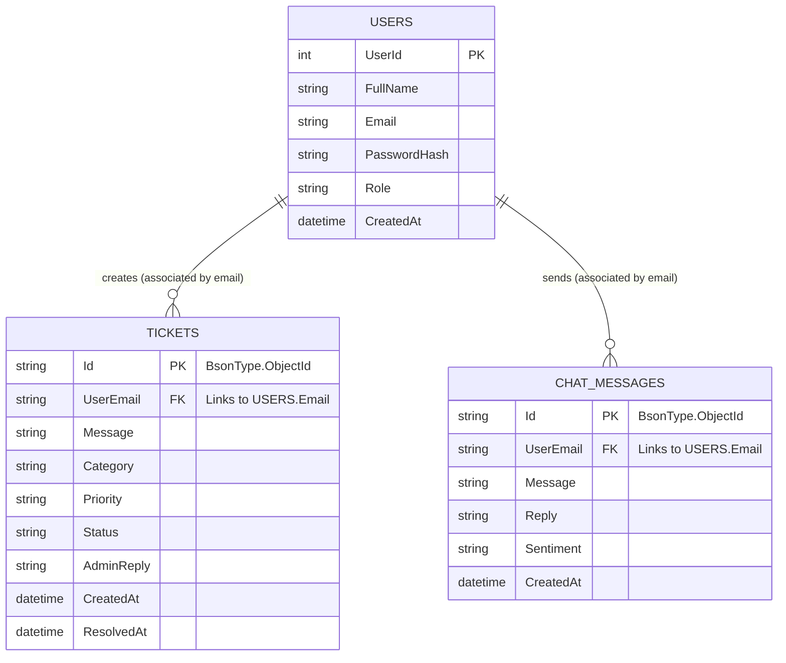

#### Detailed Data Components:
1.  **SQL Server (Relational):**
    *   **Users Table:** `UserId` (PK), `FullName`, `Email`, `PasswordHash`, `Role`, `CreatedAt`.
2.  **MongoDB (NoSQL Document Store):**
    *   **Tickets Collection:** `Id` (PK), `UserEmail`, `Message`, `Category`, `Priority`, `Status`, `AdminReply`, `CreatedAt`, `ResolvedAt`.
    *   **Chats Collection:** `Id` (PK), `UserEmail`, `Message`, `Reply`, `Sentiment`, `CreatedAt`.

### 3.6 Software System Attributes
*   **Reliability:** Redundancy in service fallback to Gemini if ML models timeout.
*   **Security:** Role-based access security filtering `/api/Admin` endpoints only to authorized tokens.
*   **Portability:** Decoupled backend and frontend services allow cloud hosting on any Docker-supported container system.

---

## 4. Software Design Document

### 4.1 Structural Design

#### A. Use Case Diagram
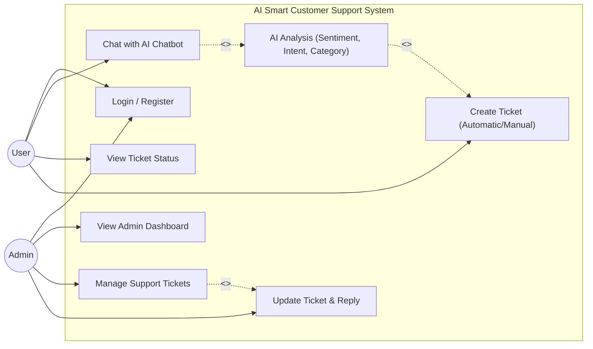

#### B. Class Diagram
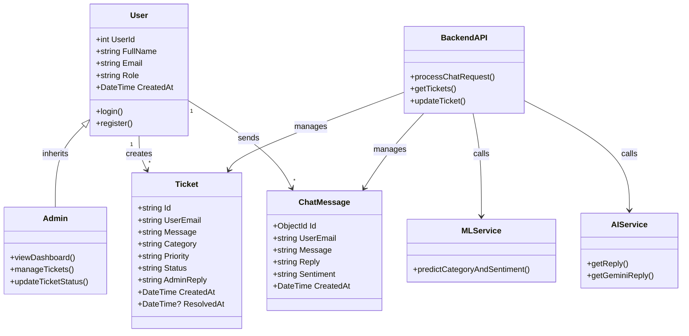

#### C. Object Diagram
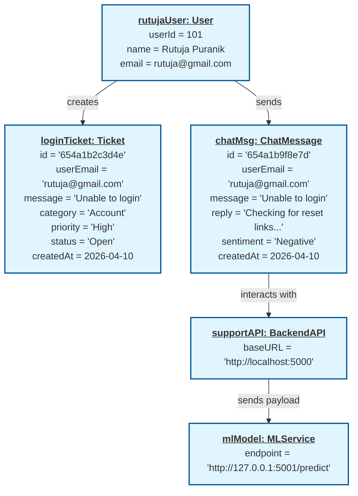

### 4.2 Data Design

#### a. Data-Flow Diagram (Level 0)
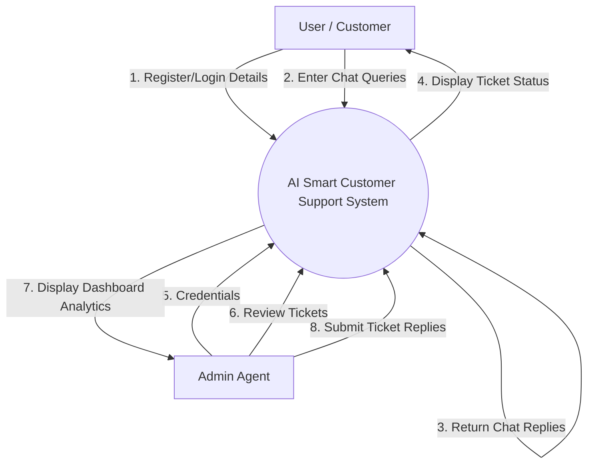

#### b. Data-Flow Diagram (Level 1)
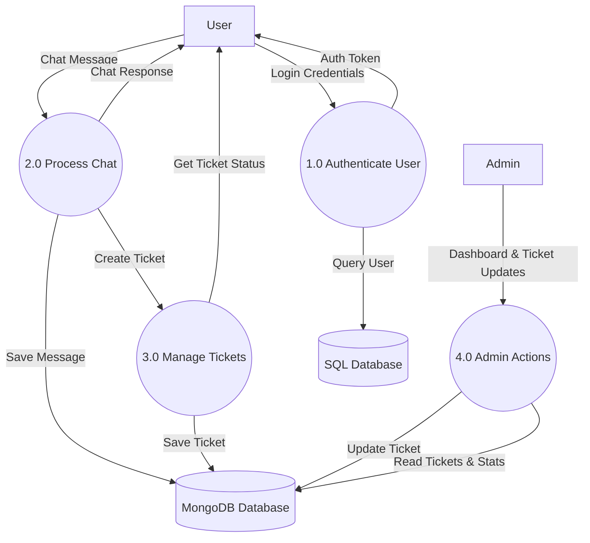

#### c. Data-Flow Diagram (Level 2)
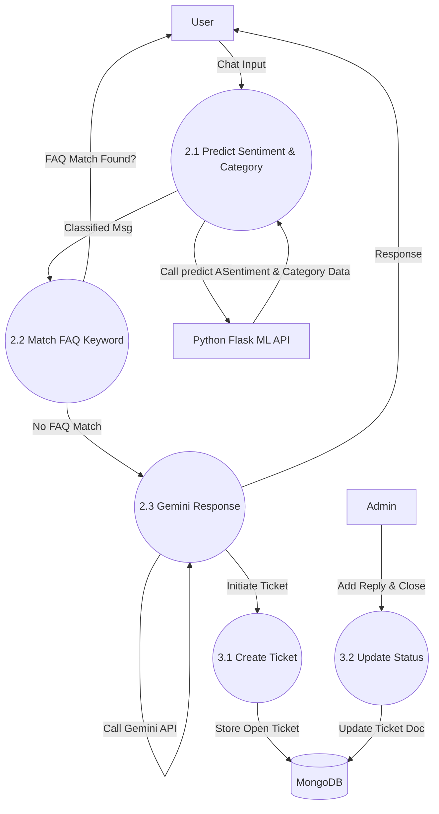

### 4.3 Behavioural Design

#### a. Sequence Diagram
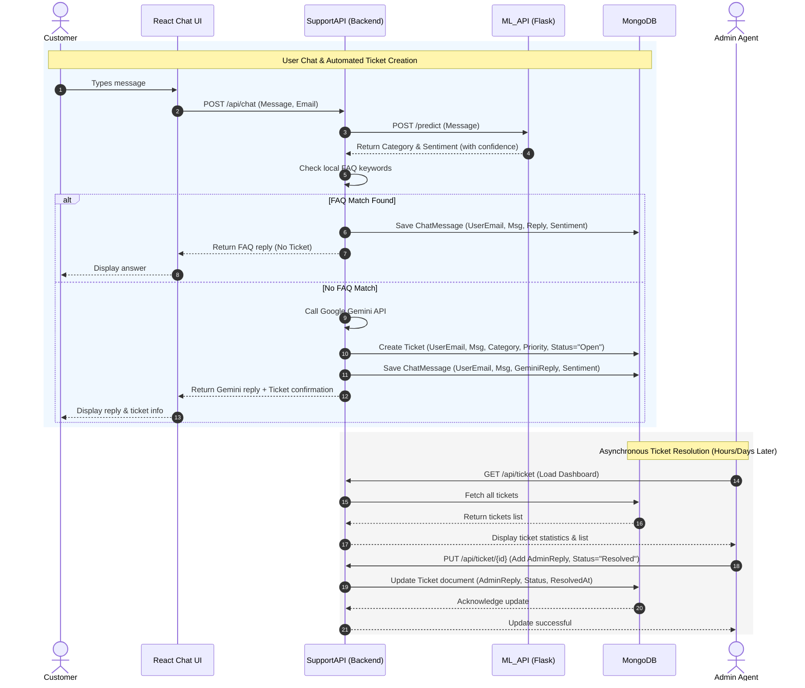

#### b. Collaboration Diagram
```mermaid
graph TD
    User((User))
    Admin((Admin))
    Chatbot[1.0 React Chat UI]
    Backend[2.0 SupportAPI]
    ML[3.0 ML_API]
    DB[(4.0 MongoDB)]
    SQL[(5.0 SQL Server)]

    User -->|1: sendQuery()| Chatbot
    Chatbot -->|2: processRequest()| Backend
    Backend -->|3: callPredict()| ML
    Backend -->|4: saveChat() / createTicket()| DB
    Backend -->|5: validateUser()| SQL
    Admin -->|6: viewDashboard() / resolveTicket()| Backend
```

#### c. Activity Diagram
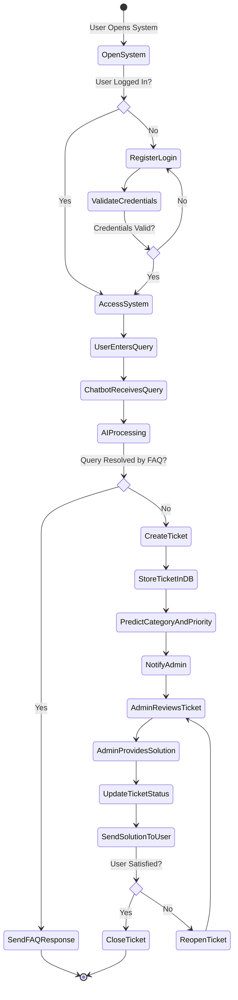

#### d. State-Chart Diagram
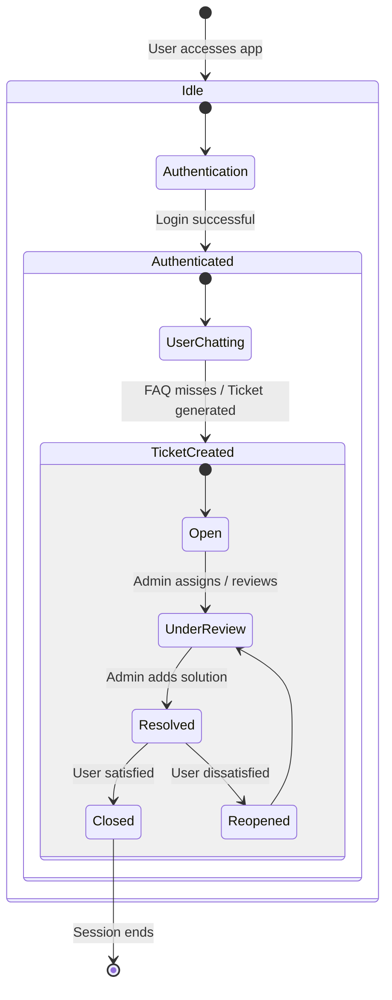

### 4.4 Implementation Design

#### a. Component Diagram
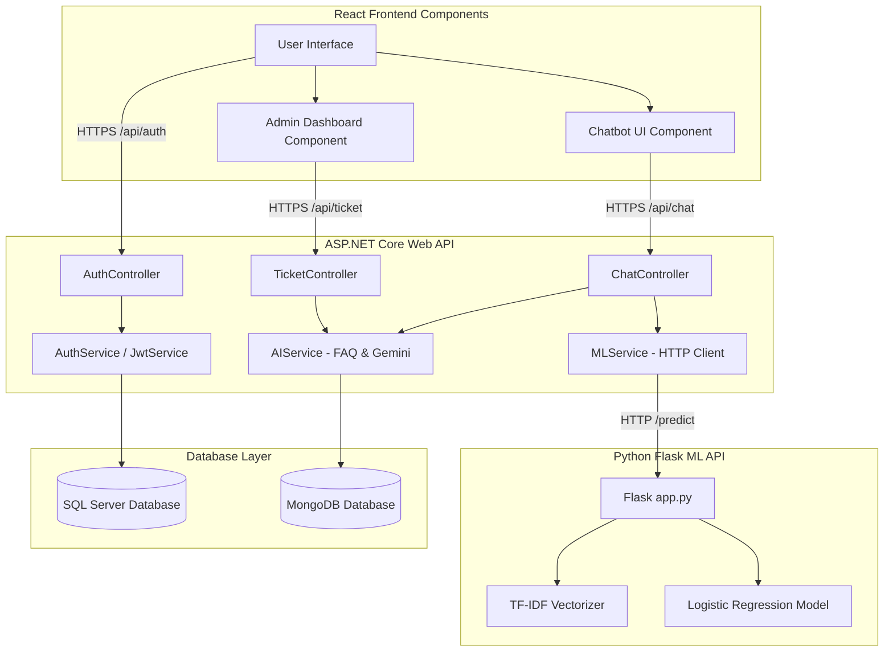

### 4.5 Environment Design

#### a. Deployment Diagram
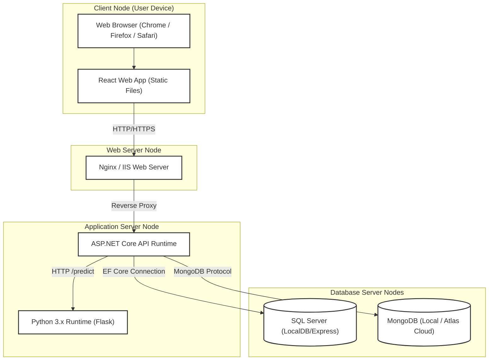

---

## 5. Algorithms for Functional Requirements

### 5.1 User Authentication Algorithm (JWT Authentication)
*   **Purpose:** Securely log in users and provide session validation.
*   **Working:**
    1.  User posts Email and Password.
    2.  System retrieves matching hashed password from the SQL Server database.
    3.  If valid, system generates a signed JWT payload including `UserId` and `Role`.
    4.  The token is returned to the React frontend.
    5.  The frontend embeds this token in authorization headers for subsequent requests.

### 5.2 Chatbot Response Algorithm (Hybrid Keyword & Generative Fallback)
*   **Purpose:** Resolve customer issues immediately using automated replies.
*   **Working:**
    1.  System captures chat string.
    2.  Local string analyzer matches against predefined keywords (billing, payment error, returns).
    3.  If matched, returns the corresponding static message immediately.
    4.  If no match, calls the custom Python ML API to get category & sentiment data.
    5.  Fires a request to Google Gemini API (injecting category, sentiment, and context).
    6.  Saves the response as a support ticket in MongoDB with "Open" status.

### 5.3 Sentiment Analysis Algorithm (TF-IDF + Logistic Regression)
*   **Purpose:** Classify the user's emotion into Positive, Negative, or Neutral.
*   **Algorithm:** Pipeline (TF-IDF Vectorizer + Logistic Regression Classifier).
*   **Working:**
    1.  Raw message text is cleaned (lowercased, punctuation removed).
    2.  Text features are extracted using TF-IDF (Term Frequency-Inverse Document Frequency) up to bigrams.
    3.  Logistic Regression model calculates probabilities for each class.
    4.  Returns predicted sentiment string along with confidence score.

### 5.4 Ticket Classification Algorithm (TF-IDF + Logistic Regression)
*   **Purpose:** Assign support issues to Technical, Billing, Account, or General.
*   **Algorithm:** Pipeline (TF-IDF Vectorizer + Logistic Regression Classifier).
*   **Working:**
    1.  User message is run through clean-text pipelines.
    2.  Predicts topic categories based on a model trained on IT Helpdesk logs and support datasets.
    3.  Returns class with the highest probability.

### 5.5 Ticket Priority Prediction Algorithm
*   **Purpose:** Determine ticket urgency automatically.
*   **Algorithm:** Rule-Based Mapping.
*   **Working:**
    1.  Sentiment value is loaded from the Sentiment Analysis output.
    2.  If Sentiment = "Negative", Priority is set to "High" (indicates frustrated customer).
    3.  Otherwise, Priority is set to "Medium".

### 5.6 Database Storage Algorithm
*   **Purpose:** Split structured transaction data and unstructured document logs.
*   **Strategy:** Dual Hybrid Storage.
*   **Working:**
    1.  User profile registrations are written to SQL Server relational tables using Entity Framework Core.
    2.  Ticketing entries and conversation log blocks are written asynchronously to MongoDB collections as BSON documents.

---

## 6. References
1.  **AI-based Customer Support Systems:** Zhang, Y., Chen, X. *Intelligent Customer Support Systems Using NLP and Machine Learning*. IEEE Access, 2023.
2.  **Sentiment Analysis in Customer Feedback:** Kumar, A., Singh, R. *Sentiment Analysis of Customer Reviews Using Machine Learning Techniques*. International Conference on AI & Data Science, 2022.
3.  **Ticket Classification using ML:** Li, H., Wang, T. *Automated Support Ticket Classification Using Text Mining*. Springer (Machine Learning Applications), 2024.
4.  **Chatbot Systems for Customer Service:** Adamopoulou, E., Moussiades, L. *Chatbots: History, Technology, and Applications*. Applied Sciences, 2022.
5.  **Hybrid Database Systems (SQL + NoSQL):** Stonebraker, M., et al. *SQL vs NoSQL Databases: A Hybrid Approach*. Communications of the ACM, 2023.
